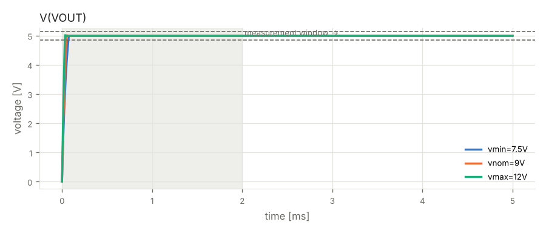

# Verification report — Phase 4 — re-verification

- design: `runs/20261015-023716/iter_05/design.py`
- result: **PASSED**

| gate | status | errors | warnings |
|---|---|---|---|
| G1 build (design.py -> netlist) | PASS | 0 | 0 |
| G2 ERC | PASS | 0 | 1 |
| G3 simulation | PASS | 0 | 0 |
| G4 regression vs Phase 1 | PASS | 0 | 0 |
| G5 fault injection | PASS | 0 | 0 |
| G6 perfboard layout | PASS | 0 | 0 |

## G2 ERC — PASS

- **WARNING** `erc.skidl`: Insufficient drive current on net VPROT for pin POWER-IN pin 1/IN of LM2940CT-5.0/U1.

## G3 simulation — PASS

| criterion | scenario | value | limit | result |
|---|---|---|---|---|
| dc_voltage_VOUT | vmin=7.5V | 4.998 | 4.85..5.15 V | ok |
| ripple_VOUT | vmin=7.5V | 8.882e-16 | <= 0.02 Vpp | ok |
| input_power | vmin=7.5V | 0.787 | <= 1.5 W | ok |
| dc_voltage_VOUT | vnom=9V | 4.998 | 4.85..5.15 V | ok |
| ripple_VOUT | vnom=9V | 1.776e-15 | <= 0.02 Vpp | ok |
| input_power | vnom=9V | 0.9445 | <= 1.5 W | ok |
| dc_voltage_VOUT | vmax=12V | 4.998 | 4.85..5.15 V | ok |
| ripple_VOUT | vmax=12V | 4.441e-15 | <= 0.02 Vpp | ok |
| input_power | vmax=12V | 1.26 | <= 1.5 W | ok |
- note: F1: simulated with an equivalent model — untripped state only (typ. ~1 ohm); trip behaviour is not simulated
- note: connectors treated as ideal wiring (not rated in simulation): J1, J2

## G4 regression vs Phase 1 — PASS

| criterion | scenario | value | limit | result |
|---|---|---|---|---|
| dc_voltage_VOUT | vmax=12V | 4.998 | baseline 4.998, within acceptance | ok |
| input_power | vmax=12V | 1.26 | baseline 1.25959, within acceptance | ok |
| ripple_VOUT | vmax=12V | 4.441e-15 | baseline 0.0, within acceptance | ok |
| dc_voltage_VOUT | vmin=7.5V | 4.998 | baseline 4.998, within acceptance | ok |
| input_power | vmin=7.5V | 0.787 | baseline 0.787, within acceptance | ok |
| ripple_VOUT | vmin=7.5V | 8.882e-16 | baseline 0.0, within acceptance | ok |
| dc_voltage_VOUT | vnom=9V | 4.998 | baseline 4.998, within acceptance | ok |
| input_power | vnom=9V | 0.9445 | baseline 0.94453, within acceptance | ok |
| ripple_VOUT | vnom=9V | 1.776e-15 | baseline 0.0, within acceptance | ok |

## G5 fault injection — PASS

| criterion | scenario | value | limit | result |
|---|---|---|---|---|
| V(VOUT) | fault:reverse_12v | 0 | -0.3..5.5 V | ok |
| |I(input)| | fault:reverse_12v | 1.003e-05 | <= 0.01 A | ok |
| abs-max ratings | fault:reverse_12v | 0 | 0 violations | ok |

## Not verified

- F1: simulated with an equivalent model — untripped state only (typ. ~1 ohm); trip behaviour is not simulated
- connectors treated as ideal wiring (not rated in simulation): J1, J2

## Component stress (worst case over all supply corners)

| part | rating | worst value | derated limit | utilisation |
|---|---|---|---|---|
| U1 (LM2940CT-5.0) | power | 0.7219 | 0.8 | 90% |
| F1 (PTC_RXEF020) | current I(pin 1) | 0.105 | -0.16..0.16 | 66% |
| U1 (LM2940CT-5.0) | voltage V(1,2) | 11.63 | -12..20.8 | 56% |
| C2 (C_ELEC_16V) | voltage V(1,2) | 4.998 | -0.4..12.8 | 39% |
| C1 (C_CER_50V) | voltage V(1,2) | 11.63 | -40..40 | 29% |
| D1 (1N5819) | voltage V(2,1) | -0.2557 | -1.6..32 | 16% |
| D1 (1N5819) | current I(pin 1) | 0.105 | -0.8..0.8 | 13% |
| U1 (LM2940CT-5.0) | current I(pin 3) | -0.1 | -0.8..0.8 | 13% |
| D1 (1N5819) | power | 0.02685 | 0.5 | 5% |
| F1 (PTC_RXEF020) | voltage V(1,2) | 0.105 | -57.6..57.6 | 0% |

## Board

- size: 9 × 9 holes (22.9 × 22.9 mm)
- solder-side runs: 10, jumpers: 0

## Waveforms

## Items not verified by simulation

- F1: simulated with an equivalent model — untripped state only (typ. ~1 ohm); trip behaviour is not simulated
- connectors treated as ideal wiring (not rated in simulation): J1, J2
- physical layout parasitics, thermal coupling and EMC are not simulated
- behavioural SPICE models are approximations of typical datasheet behaviour
