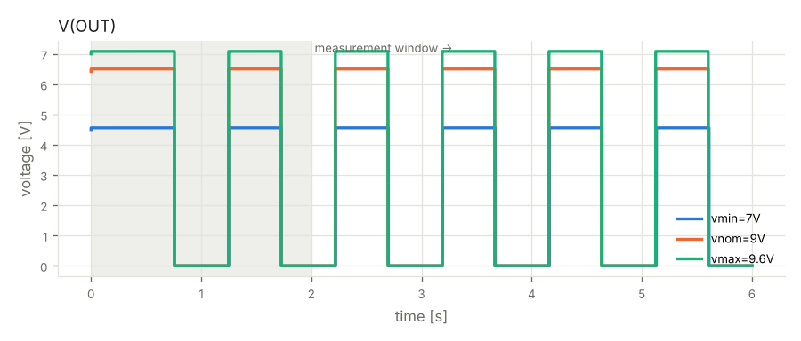

# Verification report — Phase 4 — re-verification

- design: `runs/20261015-023716/iter_05/design.py`
- result: **PASSED**

| gate | status | errors | warnings |
|---|---|---|---|
| G1 build (design.py -> netlist) | PASS | 0 | 0 |
| G2 ERC | PASS | 0 | 1 |
| G3 simulation | PASS | 0 | 0 |
| G4 regression vs Phase 1 | PASS | 0 | 0 |
| G5 fault injection | PASS | 0 | 0 |
| G6 perfboard layout | PASS | 0 | 0 |

## G2 ERC — PASS

- **WARNING** `erc.skidl`: Insufficient drive current on net VCC for pin POWER-IN pin 8/VCC of NE555/U1.

## G3 simulation — PASS

| criterion | scenario | value | limit | result |
|---|---|---|---|---|
| frequency_OUT | vmin=7V | 1.03 | 0.85..1.15 Hz | ok |
| input_power | vmin=7V | 0.06629 | <= 0.25 W | ok |
| frequency_OUT | vnom=9V | 1.031 | 0.85..1.15 Hz | ok |
| input_power | vnom=9V | 0.113 | <= 0.25 W | ok |
| frequency_OUT | vmax=9.6V | 1.032 | 0.85..1.15 Hz | ok |
| input_power | vmax=9.6V | 0.1295 | <= 0.25 W | ok |
- note: connectors treated as ideal wiring (not rated in simulation): J1, J2

## G4 regression vs Phase 1 — PASS

| criterion | scenario | value | limit | result |
|---|---|---|---|---|
| frequency_OUT | vmax=9.6V | 1.032 | baseline 1.03171, within acceptance | ok |
| input_power | vmax=9.6V | 0.1295 | baseline 0.12949, within acceptance | ok |
| frequency_OUT | vmin=7V | 1.03 | baseline 1.03036, within acceptance | ok |
| input_power | vmin=7V | 0.06629 | baseline 0.06629, within acceptance | ok |
| frequency_OUT | vnom=9V | 1.031 | baseline 1.03147, within acceptance | ok |
| input_power | vnom=9V | 0.113 | baseline 0.11303, within acceptance | ok |

## G5 fault injection — PASS

| criterion | scenario | value | limit | result |
|---|---|---|---|---|
| |I(input)| | fault:reverse_battery | 7.048e-09 | <= 0.005 A | ok |
| abs-max ratings | fault:reverse_battery | 0 | 0 violations | ok |

## G6 perfboard layout — PASS

- **INFO** `layout.jumpers`: 2 insulated jumper wire(s)

## Not verified

- connectors treated as ideal wiring (not rated in simulation): J1, J2

## Component stress (worst case over all supply corners)

| part | rating | worst value | derated limit | utilisation |
|---|---|---|---|---|
| D2 (LED_RED_5MM) | voltage V(2,1) | -1.883 | -2.4..4 | 78% |
| U1 (NE555) | voltage V(8,1) | 8.912 | -0.24..12.8 | 70% |
| U1 (NE555) | voltage V(4,1) | 8.912 | -0.24..12.8 | 70% |
| R1 (R_1/4W) | power | 0.0763 | 0.125 | 61% |
| D2 (LED_RED_5MM) | power | 0.02087 | 0.0375 | 56% |
| D2 (LED_RED_5MM) | current I(pin 1) | 0.01108 | -0.02..0.02 | 55% |
| C1 (C_ELEC_16V) | voltage V(1,2) | 5.935 | -0.4..12.8 | 46% |
| U1 (NE555) | voltage V(2,1) | 5.935 | -0.24..12.8 | 46% |
| U1 (NE555) | voltage V(6,1) | 5.935 | -0.24..12.8 | 46% |
| R3 (R_1/4W) | power | 0.05772 | 0.125 | 46% |
| D1 (1N4007) | voltage V(2,1) | -0.6975 | -1.6..800 | 44% |
| C2 (C_CER_50V) | voltage V(1,2) | 8.912 | -40..40 | 22% |
| U1 (NE555) | power | 0.05214 | 0.3 | 17% |
| C3 (C_CER_50V) | voltage V(1,2) | 5.94 | -40..40 | 15% |
| U1 (NE555) | current I(pin 3) | -0.01108 | -0.16..0.16 | 7% |
| R1 (R_1/4W) | voltage V(1,2) | 8.735 | -200..200 | 4% |
| R2 (R_1/4W) | voltage V(1,2) | 5.841 | -200..200 | 3% |
| R3 (R_1/4W) | voltage V(1,2) | 5.209 | -200..200 | 3% |
| D1 (1N4007) | power | 0.0103 | 0.5 | 2% |
| D1 (1N4007) | current I(pin 1) | 0.01477 | -0.8..0.8 | 2% |
| R2 (R_1/4W) | power | 0.0005017 | 0.125 | 0% |

## Board

- size: 13 × 11 holes (33.0 × 27.9 mm)
- solder-side runs: 18, jumpers: 2

## Waveforms

## Items not verified by simulation

- connectors treated as ideal wiring (not rated in simulation): J1, J2
- physical layout parasitics, thermal coupling and EMC are not simulated
- behavioural SPICE models are approximations of typical datasheet behaviour
