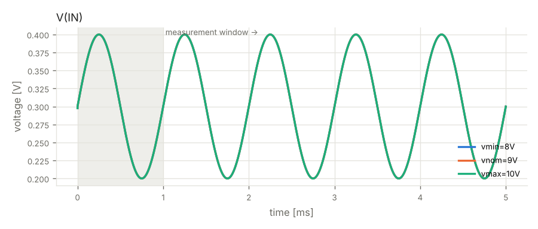
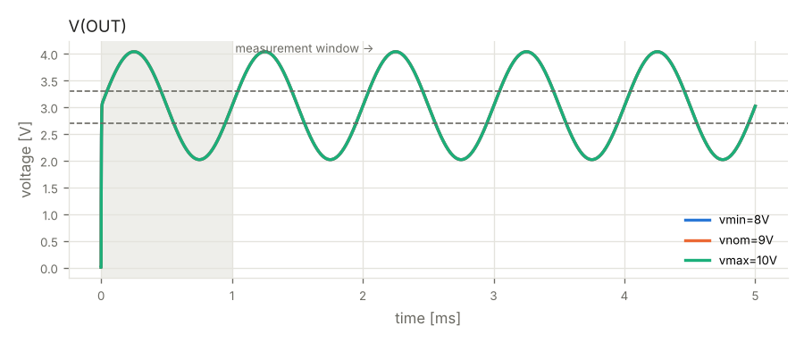

# Verification report — Phase 4 — re-verification

- design: `runs/20261015-023716/iter_05/design.py`
- result: **PASSED**

| gate | status | errors | warnings |
|---|---|---|---|
| G1 build (design.py -> netlist) | PASS | 0 | 0 |
| G2 ERC | PASS | 0 | 1 |
| G3 simulation | PASS | 0 | 0 |
| G4 regression vs Phase 1 | PASS | 0 | 0 |
| G5 fault injection | PASS | 0 | 0 |
| G6 perfboard layout | PASS | 0 | 0 |

## G2 ERC — PASS

- **WARNING** `erc.skidl`: Insufficient drive current on net VCC for pin POWER-IN pin 8/VCC of LM358/U1.

## G3 simulation — PASS

| criterion | scenario | value | limit | result |
|---|---|---|---|---|
| gain_OUT | vmin=8V | 10.1 | 9.5..10.5 V/V | ok |
| dc_voltage_OUT | vmin=8V | 3.03 | 2.7..3.3 V | ok |
| input_power | vmin=8V | 0.01062 | <= 0.1 W | ok |
| gain_OUT | vnom=9V | 10.1 | 9.5..10.5 V/V | ok |
| dc_voltage_OUT | vnom=9V | 3.03 | 2.7..3.3 V | ok |
| input_power | vnom=9V | 0.01196 | <= 0.1 W | ok |
| gain_OUT | vmax=10V | 10.1 | 9.5..10.5 V/V | ok |
| dc_voltage_OUT | vmax=10V | 3.03 | 2.7..3.3 V | ok |
| input_power | vmax=10V | 0.01331 | <= 0.1 W | ok |
- note: connectors treated as ideal wiring (not rated in simulation): J1, J2, J3

## G4 regression vs Phase 1 — PASS

| criterion | scenario | value | limit | result |
|---|---|---|---|---|
| dc_voltage_OUT | vmax=10V | 3.03 | baseline 3.02969, within acceptance | ok |
| gain_OUT | vmax=10V | 10.1 | baseline 10.09834, within acceptance | ok |
| input_power | vmax=10V | 0.01331 | baseline 0.01331, within acceptance | ok |
| dc_voltage_OUT | vmin=8V | 3.03 | baseline 3.02969, within acceptance | ok |
| gain_OUT | vmin=8V | 10.1 | baseline 10.09835, within acceptance | ok |
| input_power | vmin=8V | 0.01062 | baseline 0.01062, within acceptance | ok |
| dc_voltage_OUT | vnom=9V | 3.03 | baseline 3.02969, within acceptance | ok |
| gain_OUT | vnom=9V | 10.1 | baseline 10.09835, within acceptance | ok |
| input_power | vnom=9V | 0.01196 | baseline 0.01196, within acceptance | ok |

## G5 fault injection — PASS

| criterion | scenario | value | limit | result |
|---|---|---|---|---|
| |I(input)| | fault:reverse_supply | 7.056e-09 | <= 0.005 A | ok |
| abs-max ratings | fault:reverse_supply | 0 | 0 violations | ok |

## Not verified

- connectors treated as ideal wiring (not rated in simulation): J1, J2, J3

## Component stress (worst case over all supply corners)

| part | rating | worst value | derated limit | utilisation |
|---|---|---|---|---|
| C2 (C_ELEC_25V) | voltage V(1,2) | 9.421 | -0.4..20 | 47% |
| U1 (LM358) | voltage V(8,4) | 9.421 | -0.24..25.6 | 37% |
| D1 (1N4007) | voltage V(2,1) | -0.5854 | -1.6..800 | 37% |
| C1 (C_CER_50V) | voltage V(1,2) | 9.421 | -40..40 | 24% |
| U1 (LM358) | power | 0.01109 | 0.415 | 3% |
| U1 (LM358) | current I(pin 1) | -0.0008039 | -0.032..0.032 | 3% |
| R2 (R_1/4W) | voltage V(1,2) | 3.64 | -200..200 | 2% |
| U1 (LM358) | voltage V(3,4) | 0.4 | -0.24..25.6 | 2% |
| U1 (LM358) | voltage V(2,4) | 0.3999 | -0.24..25.6 | 2% |
| R2 (R_1/4W) | power | 0.001456 | 0.125 | 1% |
| D2 (1N4148) | voltage V(2,1) | 0.4 | -1.6..80 | 0% |
| R3 (R_1/4W) | voltage V(1,2) | 0.3999 | -200..200 | 0% |
| D1 (1N4007) | current I(pin 1) | 0.001437 | -0.8..0.8 | 0% |
| D1 (1N4007) | power | 0.0008409 | 0.5 | 0% |
| R3 (R_1/4W) | power | 0.00016 | 0.125 | 0% |
| U1 (LM358) | voltage V(6,4) | 0.005 | -0.24..25.6 | 0% |
| D2 (1N4148) | current I(pin 1) | -4.702e-09 | -0.16..0.16 | 0% |
| R1 (R_1/4W) | voltage V(1,2) | 4.704e-06 | -200..200 | 0% |
| D2 (1N4148) | power | 1.531e-09 | 0.25 | 0% |
| R1 (R_1/4W) | power | 4.865e-13 | 0.125 | 0% |
| U1 (LM358) | current I(pin 7) | -1.5e-14 | -0.032..0.032 | 0% |
| U1 (LM358) | voltage V(5,4) | 0 | -0.24..25.6 | 0% |

## Board

- size: 13 × 11 holes (33.0 × 27.9 mm)
- solder-side runs: 20, jumpers: 0

## Waveforms

## Items not verified by simulation

- connectors treated as ideal wiring (not rated in simulation): J1, J2, J3
- physical layout parasitics, thermal coupling and EMC are not simulated
- behavioural SPICE models are approximations of typical datasheet behaviour
