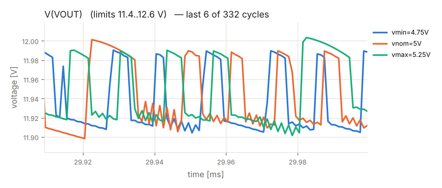

# Verification report — Phase 4 — re-verification

- design: `runs/20261016-075749/iter_05/design.py`
- result: **PASSED**

| gate | status | errors | warnings |
|---|---|---|---|
| G1 build (design.py -> netlist) | PASS | 0 | 0 |
| G2 ERC | PASS | 0 | 1 |
| G3 simulation | PASS | 0 | 0 |
| G4 regression vs Phase 1 | PASS | 0 | 0 |
| G5 fault injection | PASS | 0 | 0 |
| G6 perfboard layout | PASS | 0 | 0 |

## G2 ERC — PASS

- **WARNING** `erc.skidl`: Insufficient drive current on net VIN for pin POWER-IN pin 6/VCC of MC34063/U1.

## G3 simulation — PASS

| criterion | scenario | value | limit | result |
|---|---|---|---|---|
| dc_voltage_VOUT | vmin=4.75V | 11.93 | 11.4..12.6 V | ok |
| ripple_VOUT | vmin=4.75V | 0.1112 | <= 0.15 Vpp | ok |
| input_current | vmin=4.75V | 1.567 | <= 2.2 A | ok |
| input_power | vmin=4.75V | 7.075 | <= 10 W | ok |
| dc_voltage_VOUT | vnom=5V | 11.94 | 11.4..12.6 V | ok |
| ripple_VOUT | vnom=5V | 0.1209 | <= 0.15 Vpp | ok |
| input_current | vnom=5V | 1.465 | <= 2.2 A | ok |
| input_power | vnom=5V | 7.004 | <= 10 W | ok |
| dc_voltage_VOUT | vmax=5.25V | 11.95 | 11.4..12.6 V | ok |
| ripple_VOUT | vmax=5.25V | 0.1184 | <= 0.15 Vpp | ok |
| input_current | vmax=5.25V | 1.372 | <= 2.2 A | ok |
| input_power | vmax=5.25V | 6.918 | <= 10 W | ok |
- note: F1: simulated with an equivalent model — untripped state only (typ. ~0.07 ohm); trip behaviour is not simulated
- note: connectors treated as ideal wiring (not rated in simulation): J1, J2

## G4 regression vs Phase 1 — PASS

| criterion | scenario | value | limit | result |
|---|---|---|---|---|
| dc_voltage_VOUT | vmax=5.25V | 11.95 | baseline 11.94962, within acceptance | ok |
| input_current | vmax=5.25V | 1.372 | baseline 1.31941, within acceptance | ok |
| input_power | vmax=5.25V | 6.918 | baseline 6.66468, within acceptance | ok |
| ripple_VOUT | vmax=5.25V | 0.1184 | baseline 0.10669, within acceptance | ok |
| dc_voltage_VOUT | vmin=4.75V | 11.93 | baseline 11.94011, within acceptance | ok |
| input_current | vmin=4.75V | 1.567 | baseline 1.4855, within acceptance | ok |
| input_power | vmin=4.75V | 7.075 | baseline 6.72385, within acceptance | ok |
| ripple_VOUT | vmin=4.75V | 0.1112 | baseline 0.12532, within acceptance | ok |
| dc_voltage_VOUT | vnom=5V | 11.94 | baseline 11.94396, within acceptance | ok |
| input_current | vnom=5V | 1.465 | baseline 1.40361, within acceptance | ok |
| input_power | vnom=5V | 7.004 | baseline 6.72169, within acceptance | ok |
| ripple_VOUT | vnom=5V | 0.1209 | baseline 0.10905, within acceptance | ok |

## G5 fault injection — PASS

| criterion | scenario | value | limit | result |
|---|---|---|---|---|
| V(VOUT) | fault:overvoltage_6v | 12.05 | ..15.0 V | ok |
| abs-max ratings | fault:overvoltage_6v | 0 | 0 violations | ok |

## G6 perfboard layout — PASS

- **INFO** `layout.jumpers`: 1 insulated jumper wire(s)

## Not verified

- F1: simulated with an equivalent model — untripped state only (typ. ~0.07 ohm); trip behaviour is not simulated
- connectors treated as ideal wiring (not rated in simulation): J1, J2

## Component stress (worst case over all supply corners)

| part | rating | worst value | derated limit | utilisation |
|---|---|---|---|---|
| C2 (C_ELEC_25V_D10) | current I(pin 1) rms | 0.7241 | 0..0.8 | 91% |
| F1 (PTC_RXEF250) | current I(pin 1) rms | 1.569 | 0..2 | 78% |
| L1 (L_POWER_3A) | current I(pin 1) | 2.403 | -3.2..3.2 | 75% |
| L1 (L_POWER_3A) | current I(pin 1) rms | 1.573 | 0..2.4 | 66% |
| C2 (C_ELEC_25V_D10) | voltage V(1,2) | 12.01 | -0.4..20 | 60% |
| R4 (R_1W) | power (average) | 0.2968 | 0.5 | 59% |
| U1 (MC34063) | current I(pin 2) | -0.7044 | -1.2..1.2 | 59% |
| U1 (MC34063) | current I(pin 1) | 0.7006 | -1.2..1.2 | 58% |
| Q1 (IRLZ44N) | voltage V(1,3) | 6.894 | -12.8..12.8 | 54% |
| C1 (C_ELEC_16V) | voltage V(1,2) | 4.979 | -0.4..12.8 | 39% |
| Q1 (IRLZ44N) | power (average) | 0.3839 | 1 | 38% |
| D1 (1N5822) | voltage V(2,1) | 11.95 | -1.6..32 | 37% |
| Q1 (IRLZ44N) | voltage V(2,3) | 12.35 | -1.2..44 | 28% |
| D1 (1N5822) | current I(pin 1) average | 0.4998 | -2.4..2.4 | 21% |
| R1 (R_1/4W) | power (average) | 0.02176 | 0.125 | 17% |
| U1 (MC34063) | voltage V(6,4) | 4.979 | -0.24..32 | 16% |
| U1 (MC34063) | voltage V(1,4) | 4.979 | -0.24..32 | 16% |
| D1 (1N5822) | current I(pin 1) | 2.368 | -16..16 | 15% |
| D1 (1N5822) | power (average) | 0.1387 | 1 | 14% |
| C3 (C_CER_50V) | voltage V(1,2) | 4.979 | -40..40 | 12% |
| R2 (R_1/4W) | voltage V(1,2) | 10.76 | -200..200 | 5% |
| R2 (R_1/4W) | power (average) | 0.006359 | 0.125 | 5% |
| U1 (MC34063) | voltage V(5,4) | 1.255 | -0.24..32 | 4% |
| Q1 (IRLZ44N) | current I(pin 2) rms | 1.296 | 0..37.6 | 3% |
| R1 (R_1/4W) | voltage V(1,2) | 6.894 | -200..200 | 3% |
| C4 (C_CER_50V) | voltage V(1,2) | 1.223 | -40..40 | 3% |
| U1 (MC34063) | power (average) | 0.01779 | 0.625 | 3% |
| Q1 (IRLZ44N) | current I(pin 2) | 2.393 | -128..128 | 2% |
| R3 (R_1/4W) | voltage V(1,2) | 1.255 | -200..200 | 1% |
| R3 (R_1/4W) | power (average) | 0.0007416 | 0.125 | 1% |
| F1 (PTC_RXEF250) | voltage V(1,2) | 0.1327 | -24..24 | 1% |
| R4 (R_1W) | voltage V(1,2) | 0.2884 | -280..280 | 0% |

## Board

- size: 17 × 15 holes (43.2 × 38.1 mm)
- solder-side runs: 25, jumpers: 1

## Waveforms

## Items not verified by simulation

- F1: simulated with an equivalent model — untripped state only (typ. ~0.07 ohm); trip behaviour is not simulated
- connectors treated as ideal wiring (not rated in simulation): J1, J2
- physical layout parasitics, thermal coupling and EMC are not simulated
- behavioural SPICE models are approximations of typical datasheet behaviour
